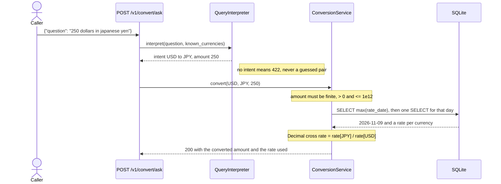

# currency-exchange

The European Central Bank publishes one file a day: the euro reference rates, in
XML, on working days only. This service reads it, keeps every day it has seen,
and answers what the raw file cannot: what a currency did since yesterday,
what 250 dollars is in yen, what the rate was last Tuesday.

Rates are euro-based, so any other pair is a cross rate through EUR, and an
answer always cites the rate and publication date it came from.

```console
$ curl -s 'http://localhost:8000/v1/convert?from=USD&to=JPY&amount=100'
{"source":"USD","target":"JPY","amount":100.0,"converted":15604.4691,
 "rate":156.0446906,"rate_date":"2026-11-09","base":"EUR"}
```

Every response in this README was captured from the Compose stack below,
running on the built-in `static` snapshot, so the figures are a frozen sample
rather than a real quote.

## Getting it running

### With Docker Compose

```bash
docker compose up --build
curl -s http://localhost:8000/healthz
```

Two services share one image: a one-shot `seed` container that fills a named
volume, and `api`, which starts only once seeding has succeeded. Both default
to the offline `static` snapshot; `RATES_PROVIDER=ecb docker compose up` seeds
from and refreshes against the live ECB file instead. `API_PORT` moves the
published port.

The image is multi-stage: dependencies go into a virtualenv that is copied into
a `python:3.13-slim` runtime, the process runs as uid 10001, and Docker polls
`/healthz`. The seed step prints what it stored:

```text
seed-1  | Fetching rates from the "static" provider...
seed-1  | Stored 30 quotes for 2026-11-09 (30 new, 0 updated).
seed-1  | No earlier snapshot, so day-over-day change is empty.
```

### Without Docker

Python 3.13 (pinned in `.python-version`). No database server, no API key and
no network needed.

```bash
python3 -m venv .venv && source .venv/bin/activate
pip install -r requirements.txt

RATES_PROVIDER=static python -m app.cli seed   # drop the variable for live ECB rates
RATES_PROVIDER=static uvicorn app.main:app --reload
```

Open <http://localhost:8000/docs> for the OpenAPI page, or `GET /` for the
endpoint list. `python -m app.cli show` prints the stored snapshot without
starting a server. Every setting has a working default; copy `.env.example`
to see them all in one place.

## What you can ask it

| Endpoint | What it answers |
| --- | --- |
| `GET /healthz` | Is the database reachable, and how old is the newest snapshot |
| `GET /v1/rates` | The newest published snapshot, paged and filterable |
| `GET /v1/rates/{currency}` | One currency, with its move since the previous published day |
| `GET /v1/rates/{currency}/history` | The last N publication dates for it |
| `GET /v1/convert` | `from`, `to` and `amount`, at the newest rates |
| `POST /v1/convert/ask` | The same conversion, asked in a sentence |

Listings report `total`, `limit`, `offset` and `has_more`. `limit` is clamped
to `MAX_PAGE_SIZE`, so `?limit=10000` still returns 200 rows at most, and
repeating `?currency=USD&currency=JPY` narrows a page.

```console
$ curl -s 'http://localhost:8000/v1/rates?limit=3'
{"rate_date":"2026-11-09","base":"EUR","total":30,"limit":3,"offset":0,
 "has_more":true,"rates":[
  {"currency":"AUD","rate":1.6543,"change":null,"rate_date":"2026-11-09"},
  {"currency":"BGN","rate":1.9558,"change":null,"rate_date":"2026-11-09"},
  {"currency":"BRL","rate":6.3412,"change":null,"rate_date":"2026-11-09"}]}

$ curl -s http://localhost:8000/healthz
{"status":"ok","version":"1.0.0","database":"reachable",
 "rates_provider":"static","nlq_interpreter":"rules",
 "latest_rate_date":"2026-11-09","latest_rate_age_days":0,
 "stored_currencies":31}
```

`change` is `null` on a currency's first stored day and the absolute move
after that. `stored_currencies` counts the euro itself.

### Errors

Each failure is a `ServiceError` mapped to a status code by one table in
`app/main.py`, and each says what went wrong:

| Situation | Status | Body |
| --- | --- | --- |
| A currency the snapshot does not quote | 404 | `{"detail":"no rate is published for currency 'XYZ'"}` |
| Nothing ingested yet | 409 | names the `python -m app.cli seed` command |
| A code that is not three letters (`/v1/rates/123`) | 422 | FastAPI's validation error |
| An amount that is zero, negative, not finite or over one trillion | 422 | `{"detail":"amount must be greater than 0 and at most 1,000,000,000,000"}` |
| A sentence with no recognisable conversion | 422 | `{"detail":"could not work out which currencies to convert between"}` |

`/healthz` always answers 200 and reports trouble in its body instead:
`empty` before the first ingest, `stale` once the newest snapshot is older than
`STALE_AFTER_DAYS`, `degraded` if the database does not answer. The nightly
job only logs a failed fetch, so `stale` is how a dead upstream shows up.

## How the money is worked out

Rates are stored as the ECB publishes them, units of a currency per euro. For a
pair that does not involve the euro, one unit of `source` is worth
`rate[target] / rate[source]` units of `target`.

That division, the multiplication by the amount and the rounding all happen in
`Decimal`, starting from the shortest decimal form of each stored number. Binary
floats cannot hold 0.825 or 1.01 exactly, and plain `round()` on them gives
answers a person checking by hand would not:

```console
$ curl -s 'http://localhost:8000/v1/convert?from=EUR&to=GBP&amount=1.01'
{"source":"EUR","target":"GBP","amount":1.01,"converted":0.8374,
 "rate":0.8291,"rate_date":"2026-11-09","base":"EUR"}
```

Converted amounts round half-up to 4 decimal places and rates to 8. Day-over-day
moves are subtracted the same way, so 1.05 after 1.04 is stored as `0.01`, not
`0.010000000000000009`. Responses still carry JSON numbers, not strings.

Inputs are checked at the edges. A snapshot from any provider must quote
three-letter upper-case codes at positive, finite rates, so a `0` in the
upstream file is refused at ingest rather than turning into a division by zero
later. Route parameters must be three letters (either case), and an amount must
be finite, above zero and at most one trillion.

## How a question in words becomes a number

`POST /v1/convert/ask` takes a sentence. An interpreter decides *what was
asked*; the arithmetic comes from the stored rates, so the model, when one is
used at all, never produces the figure.

```console
$ curl -s -X POST http://localhost:8000/v1/convert/ask \
    -H 'Content-Type: application/json' \
    -d '{"question":"how much is 250 dollars in japanese yen"}'
{"question":"how much is 250 dollars in japanese yen","interpreter":"rules",
 "conversion":{"source":"USD","target":"JPY","amount":250.0,
 "converted":39011.1727,"rate":156.0446906,"rate_date":"2026-11-09",
 "base":"EUR"}}
```



Two interpreters implement the same `QueryInterpreter` protocol:

- **`rules`** (default, `app/ai/rules.py`): 85 aliases and 8 currency symbols
  across 31 currencies, plus an amount parser that reads `1,250.50`, `2k` and
  `3m`. Offline and deterministic, so its behaviour is asserted case by case.
- **`anthropic`** (`app/ai/anthropic_interpreter.py`): sends the question to
  Claude with a strict tool schema and reads the structured arguments back.
  Needs `NLQ_PROVIDER=anthropic`, `ANTHROPIC_API_KEY` and `pip install anthropic`.

The Claude path degrades rather than failing: missing package, missing key,
network error or unusable answer all fall through to the rule parser, and the
response names the interpreter that read the question. It needs a live key, so
**the suite does not exercise the call itself**; what it covers is that the
fallback fires and returns the right conversion. One deliberate ambiguity: bare
"dollar" means USD, bare "peso" means PHP.

## Where the rates come from

`RateProvider` is a protocol over "a dated set of euro rates", with two
implementations registered in `app/providers/__init__.py`. `ecb` reads the live
`eurofxref-daily` document over HTTPS with a timeout and turns network or parse
trouble into `RateProviderError`. `static` returns a fixed 30-currency snapshot
dated today, so the service, the tests and Compose all run offline.

- **It stores the ECB's own publication date.** The ECB skips weekends and
  TARGET holidays, so "the latest rates" is the newest `rate_date` in the
  table, never "today".
- **It computes every day-over-day move in one query.** The previous snapshot
  is read with a single `SELECT` keyed on `rate_date`, not one lookup per
  currency, and the whole day is written in one transaction.
- **It is idempotent.** `(currency, rate_date)` is unique and a repeat run
  updates in place, so re-seeding or retrying cannot duplicate a day.

An APScheduler cron job runs that same path just after midnight
(`INGEST_HOUR`, `INGEST_MINUTE`), logging failures instead of raising: a bad
fetch should not take the API down with it.

## Settings

Read from the environment in `app/config.py` and nowhere else.

| Variable | Default | Notes |
| --- | --- | --- |
| `DATABASE_URL` | `sqlite:///./exchange_rate.db` | Any SQLAlchemy URL |
| `RATES_PROVIDER` | `ecb` (`static` under Compose) | `ecb` or `static` |
| `ECB_URL` | the ECB daily file | Point it at a mirror or a fixture server |
| `HTTP_TIMEOUT_SECONDS` | `10.0` | Upstream fetch timeout |
| `SCHEDULER_ENABLED` | `true` | Off for tests and one-shot runs |
| `INGEST_HOUR` / `INGEST_MINUTE` | `0` / `2` | When the daily fetch runs |
| `STALE_AFTER_DAYS` | `5` | Snapshot age at which `/healthz` says `stale`; 5 covers the Easter gap |
| `DEFAULT_PAGE_SIZE` / `MAX_PAGE_SIZE` | `50` / `200` | The cap is server-side |
| `NLQ_PROVIDER` | `rules` | `rules` or `anthropic` |
| `ANTHROPIC_MODEL` / `ANTHROPIC_API_KEY` | `claude-opus-5` / unset | Read only when `NLQ_PROVIDER=anthropic`; never commit a key |

## Layers

```
app/
  config.py        the only module that reads os.environ
  db.py            engine, session factory, declarative base
  models/          one table: exchange_rate
  repositories/    every SQL statement in the project
  services/        ingest, rate queries, conversion, error types
  providers/       where rates come from   (ecb | static)
  ai/              how a sentence becomes a conversion   (rules | anthropic)
  api/             routes and dependencies
  scheduler.py     the daily ingest job
  cli.py           python -m app.cli seed | show
```

Dependency runs one way: routes call services, services call repositories, and
repositories are the only code that touches SQLAlchemy. A route receives a
service through `Depends`, never a `Session`, which is what makes the whole API
testable against a throwaway database.

SQLAlchemy and the Anthropic client are synchronous, so every route that uses
them is a plain `def` and runs in FastAPI's threadpool; only the static `/`
index is `async`. A test keeps it that way.

## Checks

```bash
pip install -r requirements-dev.txt
pytest          # 168 passed
ruff check .
ruff format --check .
```

The suite runs against a temporary SQLite file and the `static` provider, so it
needs no network and no fixtures on disk; it passes with networking switched
off. It covers the ECB XML parser and its malformed cases (zero, negative and
non-finite rates, bad codes), ingest idempotency, pagination bounds, Decimal
rounding, cross-rate arithmetic both ways through EUR, amount and code
validation, the stale-snapshot threshold, every natural-language case above,
and each error's status code.

## Things it deliberately does not do

- **No authentication, and no intraday quotes.** The rates are public, and the
  ECB publishes once per working day; anything labelled "live" would misstate
  the source.
- **No currency-aware rounding.** Amounts round to 4 decimal places uniformly.
  JPY has no minor unit and BHD has three, so billing would need a real table.
- **No back-filling.** Ingest stores whatever day the provider hands it. If an
  older day were ingested after a newer one, the newer day's `change` would not
  be recomputed; the ECB daily file only ever offers the newest day.
- **No Redis, and no Postgres service in Compose.** One indexed table holding
  about 30 rows per working day needs neither. `DATABASE_URL` accepts a
  Postgres URL once a driver such as `psycopg` is installed.

## Licence

MIT, see [LICENSE](LICENSE).
